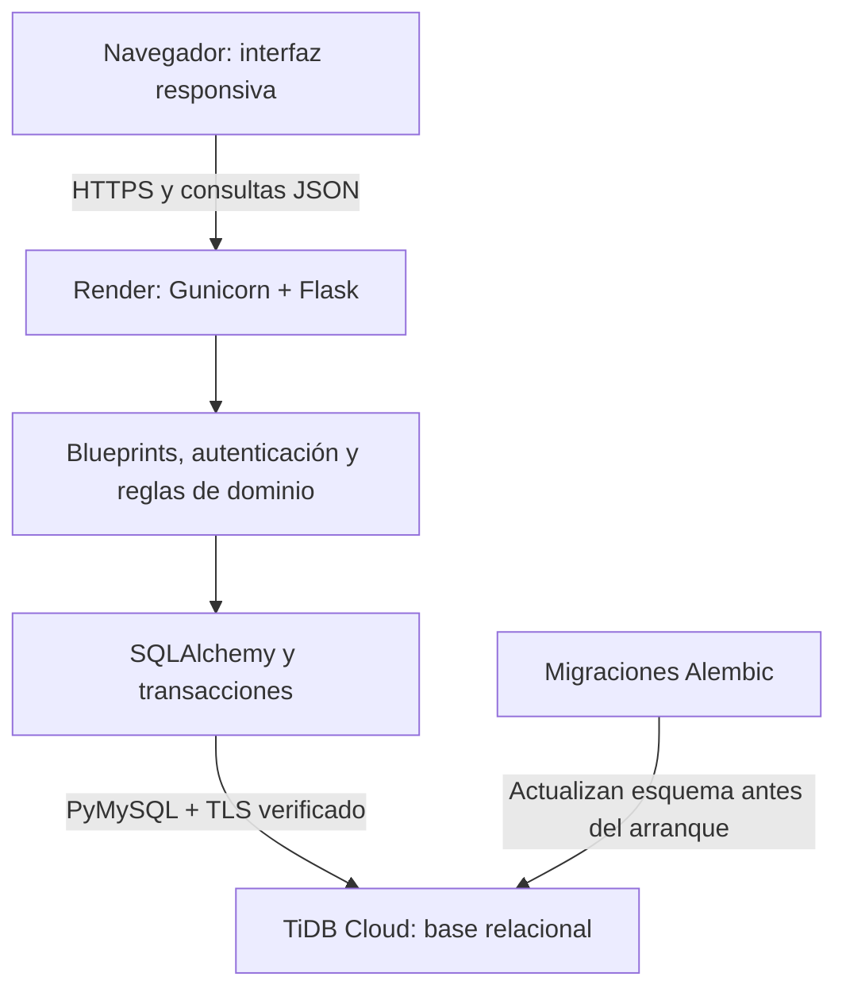
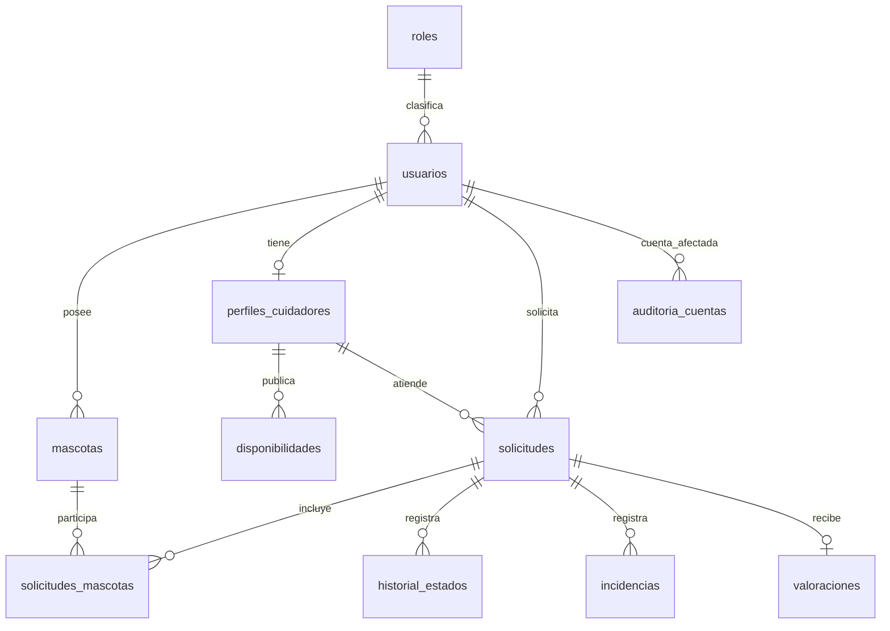
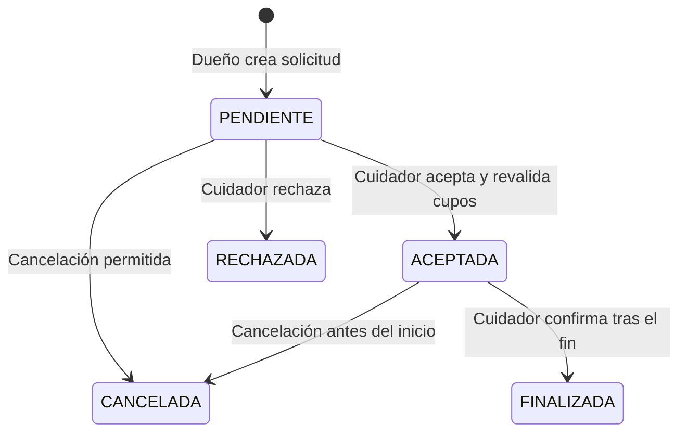
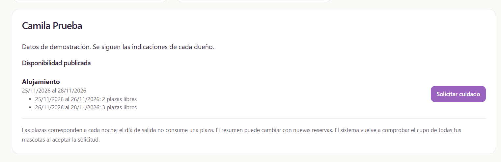
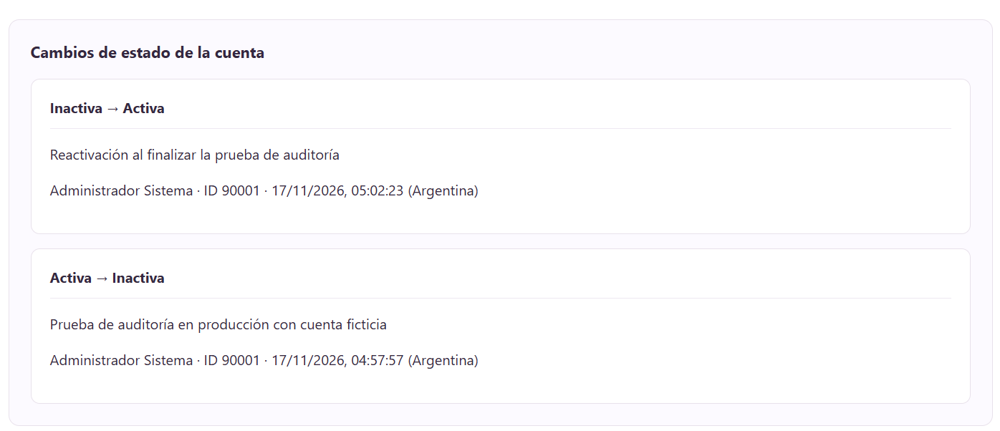

# Cuidando Peluditos

**Informe final de implementación y validación**  
**Proyecto Final — Tecnicatura Universitaria en Programación**  
**Universidad Tecnológica Nacional**

**Grupo:** 176  
**Integrantes:** Macarena Marinoni y Marianela Valletto  
**Tutor:** Oscar Londero  
**Actualización:** 17 de noviembre de 2026  
**Aplicación:** https://cuidando-peluditos.onrender.com  
**Repositorio:** https://github.com/MaquiMarinoni/TUPaD_CuidandoPeluditos_ProyFinal

**Referencia de la versión comprobada:** código funcional `dce4785`; documentación y evidencias `7f8e372`; revisión de base de datos `e72a91c4b603`. Estos identificadores corresponden a la validación del 17/11/2026 y no sustituyen la comprobación del commit final al publicar la entrega.

---

## Resumen ejecutivo

Cuidando Peluditos es una aplicación web que vincula a dueños de perros y gatos con cuidadores que ofrecen alojamiento temporal o visitas a domicilio. Centraliza usuarios, perfiles, mascotas, disponibilidad, solicitudes, coordinación, incidencias, valoraciones e historial de servicios. La versión implementada contempla tres roles: **Dueño, Cuidador y Administrador**.

Se desarrolló con Python y Flask, una interfaz responsiva basada en HTML, CSS, Bootstrap y JavaScript, y persistencia relacional mediante SQLAlchemy. Se encuentra publicada en Render con TiDB Cloud, conectada por PyMySQL y TLS con verificación de certificado. El esquema se administra mediante migraciones Alembic; la revisión comprobada en producción es `e72a91c4b603`.

La última ejecución local de la suite aislada registró **104 pruebas aprobadas y 799 advertencias no bloqueantes**. Se documentaron además pruebas locales con MariaDB y recorridos en producción sobre auditoría administrativa, privacidad de contactos, capacidad por noche, cancelaciones, visitas de 60 minutos y cálculo de tarifas por mascota. Las consultas de una incidencia y una valoración históricas se distinguen expresamente de la creación de nuevos registros en producción.

## 1. Problema, investigación y objetivos

### 1.1. Problema y propuesta

La búsqueda de cuidado temporal de mascotas suele resolverse mediante contactos personales y conversaciones dispersas. Esto dificulta comparar alternativas, conocer disponibilidad, comunicar condiciones de cuidado y conservar antecedentes de los servicios. La propuesta organiza el recorrido entre las necesidades del dueño y la oferta del cuidador, registrando las decisiones relevantes.

### 1.2. Investigación previa

La Entrega 01 documentó cinco entrevistas semiestructuradas, un *card sorting* abierto con diez participantes y cinco pruebas exploratorias de usabilidad. Se informó una completitud del 100 % de las tareas evaluadas y un tiempo medio de 54 segundos. **Son resultados de investigación previa, no mediciones del producto final desplegado.**

El criterio inicial de que al menos el 80 % de los usuarios completara el flujo sin asistencia crítica requiere una nueva evaluación con usuarios finales. Las pruebas funcionales no sustituyen esa medición.

### 1.3. Objetivos

**Objetivo general:** desarrollar una plataforma web para gestionar solicitudes de cuidado temporal de mascotas, con disponibilidad, permisos y trazabilidad.

**Objetivos específicos:** registrar usuarios y mascotas; publicar perfiles y agendas; facilitar la búsqueda; controlar solicitudes, cupos y tarifas; habilitar la coordinación entre participantes autorizados; registrar incidencias y valoraciones; conservar el historial de estados; y supervisar cuentas mediante funciones administrativas auditables.

## 2. Alcance y actores

| Actor | Operaciones implementadas |
| --- | --- |
| Visitante | Consultar cuidadores y disponibilidades públicas; debe iniciar sesión o registrarse para solicitar un cuidado. |
| Dueño | Gestionar sus mascotas, buscar cuidadores, crear y consultar solicitudes, cancelar antes del inicio, consultar incidencias y valorar servicios finalizados. |
| Cuidador | Gestionar perfil y disponibilidad, aceptar o rechazar solicitudes, cancelar antes del inicio, registrar y resolver incidencias y finalizar servicios cuando corresponda. |
| Administrador | Consultar cuentas, operaciones e indicadores; activar o desactivar cuentas no administrativas con motivo e historial de auditoría. |

Las modalidades son **alojamiento en el hogar del cuidador** y **visitas al domicilio del dueño**. Se excluyen pagos reales, chat integrado, mensajería automática, mapas, verificación automática de identidad, videollamadas y aplicaciones móviles nativas.

El panel ADMIN se incorporó durante el cierre, aunque figuraba como prioridad P2 en la Entrega 02. Su alcance operativo **no incluye moderación de reseñas ni resolución administrativa de incidencias**. Las condiciones de convivencia y la admisión de mascotas requieren, además de las reglas estructuradas, evaluación humana.

## 3. Desarrollo e integración

La Entrega 01 definió el problema, la investigación de usuarios y la propuesta tecnológica. La Entrega 02 desarrolló las reglas del dominio, el modelo relacional, la máquina de estados y un escenario de concurrencia. La implementación posterior integró backend, frontend, pruebas y despliegue.

El trabajo colaborativo se organizó mediante Git y GitHub, con ramas funcionales y una rama compartida de integración. Los últimos cambios de auditoría, privacidad y franjas de visitas se incorporaron a `deploy/render`. El código funcional validado quedó identificado como `dce4785`; el commit `7f8e372` incorporó documentación y capturas sin modificar ese comportamiento. No se asignan porcentajes individuales de participación sin un registro verificable de dedicación.

Durante el cierre se corrigieron la conservación de fechas seleccionadas, la presentación de cupos por tramo y la separación entre medidas iniciales y comentario de cierre de incidencias. También se ajustaron navegación y ayuda por rol, acceso administrativo, botones de ingreso y registro, contador de solicitudes pendientes y navegación para volver al inicio de la página. El contador representa **solicitudes pendientes**, no mensajes sin leer.

## 4. Arquitectura y tecnologías

| Componente | Implementación y responsabilidad |
| --- | --- |
| Interfaz | HTML5, CSS3, Bootstrap 5.3, JavaScript, plantillas Jinja y consultas a endpoints JSON. |
| Aplicación | Python 3, Flask 3, *Application Factory*, *Blueprints*, Flask-Login y protección CSRF con Flask-WTF. |
| Persistencia | Flask-SQLAlchemy, SQLAlchemy, Flask-Migrate/Alembic y PyMySQL. |
| Desarrollo y pruebas | MariaDB local, SQLite aislado para pytest, Git, GitHub y VS Code. |
| Producción | Render, Gunicorn y TiDB Cloud Starter, con conexión TLS verificada. |

Se trata de una **aplicación monolítica modular**. Los permisos, cálculos definitivos y reglas de aceptación se verifican en el servidor; la interfaz complementa estos controles, pero no los sustituye. No se afirma la existencia de una capa de servicios independiente ni la aplicación exhaustiva de patrones que solo figuraron como propuestas de diseño.

## 5. Modelo relacional y conservación de información

El esquema vigente contiene **once tablas de dominio y una tabla técnica**, `alembic_version`. La revisión `e72a91c4b603` incorporó `auditoria_cuentas`, después de `d18a6c2f904b`, que separó el comentario de cierre de incidencias.

| Tabla | Función principal |
| --- | --- |
| `roles` | Clasificación de permisos. |
| `usuarios` | Identidad, credenciales con hash, ubicación y estado de cuenta. |
| `mascotas` | Mascotas de un dueño, cuidados, veterinario y estado. |
| `perfiles_cuidadores` | Perfil, especies admitidas, capacidad y tarifas. |
| `disponibilidades` | Modalidad, fechas y franjas horarias. |
| `solicitudes` | Participantes, servicio, fechas, estado, total, emergencias y dirección del servicio. |
| `solicitudes_mascotas` | Asociación de mascotas y copias históricas de datos relevantes. |
| `historial_estados` | Transiciones, usuario, fecha y motivo cuando corresponde. |
| `incidencias` | Tipo, descripción, medidas iniciales, estado y comentario de cierre. |
| `valoraciones` | Puntaje y comentario asociados a un servicio finalizado. |
| `auditoria_cuentas` | Cuenta afectada, administrador, estados anterior y nuevo, motivo y fecha. |

*Figura conceptual de relaciones principales, no inventario completo de claves foráneas ni cardinalidades físicas. Para detalles exactos se deben consultar modelos y migraciones. La auditoría también identifica al administrador responsable.*

Al crear una solicitud se conservan copias históricas de nombre, especie, cuidados y veterinario de cada mascota asociada. El contacto de emergencia, la autorización de urgencia, el veterinario de emergencia y el límite de gastos corresponden a la solicitud. La dirección de visita queda asociada al servicio; la dirección privada de alojamiento se copia al aceptar, cuando fue informada. Cambios posteriores del perfil no reemplazan ese domicilio acordado. Los teléfonos y correos mostrados para coordinar son datos actuales, no copias históricas.

## 6. Reglas del dominio

### 6.1. Alojamiento y cupos por noche

El ingreso debe ser anterior a la salida y la estadía debe cubrir al menos una noche. El intervalo considera **excluido el día de salida**: una reserva del 25 al 26 ocupa la noche del 25, no la del 26. La capacidad debe alcanzar para todas las mascotas en cada noche, considerando las reservas que comprometen plazas.

**Total de alojamiento = tarifa por mascota y noche × cantidad de mascotas × cantidad de noches.**

Con una tarifa de $12.000, una mascota durante una noche cuesta $12.000; dos mascotas durante tres noches cuestan $72.000. El cálculo definitivo se realiza en el servidor.

El resumen público agrupa noches consecutivas con igual capacidad libre. Se actualiza al consultar nuevamente; **no se presenta como información en tiempo real**. Una solicitud pendiente no garantiza plaza: la aceptación vuelve a verificar disponibilidad y capacidad dentro de una transacción.

### 6.2. Visitas, duración y tarifas

Cada nueva solicitud de visita dura **exactamente 60 minutos**, termina el mismo día y puede incluir de una a tres mascotas activas del mismo dueño. El límite corresponde a la solicitud de visita, no a la cantidad total de mascotas registradas ni a la capacidad de alojamiento.

**Total de visita = tarifa por mascota y visita de 60 minutos × cantidad de mascotas.**

Con una tarifa de $8.000, una visita cuesta $8.000 para una mascota, $16.000 para dos y $24.000 para tres. El servidor calcula el importe definitivo y rechaza duraciones alteradas. La franja publicada puede ser más amplia, pero debe cubrir al menos una hora.

Las franjas antiguas insuficientes y las visitas con períodos vencidos no se ofrecen en la consulta pública, aunque se conservan en la agenda privada. Una visita compromete un intervalo del cuidador aunque incluya varias mascotas. Se comprueban además conflictos de una misma mascota entre visitas y alojamiento. Los registros anteriores conservan sus horarios e importes originales.

### 6.3. Estados, permisos y concurrencia

**No se persiste `EN_CURSO` ni se finaliza automáticamente.** La solicitud permanece `ACEPTADA` durante la prestación; el cuidador confirma el cierre una vez cumplido el período. Si no hay capacidad al aceptar, la operación falla y la solicitud sigue `PENDIENTE`, sin transformarse en rechazo voluntario.

La aceptación bloquea registros relevantes, revalida disponibilidad, capacidad y conflictos, y confirma el cambio transaccionalmente. Las pruebas locales de concurrencia en MariaDB registraron una aceptación y un conflicto al competir por el mismo turno; **no constituyen una prueba de concurrencia ejecutada en TiDB**.

### 6.4. Privacidad, emergencias e incidencias

La búsqueda pública no muestra teléfono, correo electrónico ni domicilio exacto. Los participantes autorizados de una solicitud `ACEPTADA` o `FINALIZADA` pueden consultar los contactos de coordinación; estos se ocultan en `PENDIENTE`, `RECHAZADA` y `CANCELADA`. La información privada de cuidados y emergencias se habilita según la relación del usuario con el servicio y su estado.

El contacto de emergencia cumple una finalidad distinta del contacto del dueño. La autorización de urgencia es explícita, no se encuentra activada por defecto y exige los datos y límites correspondientes cuando se concede.

El cuidador puede registrar incidencias y resolverlas mediante un comentario de cierre separado de las medidas iniciales; el dueño puede consultarlas. La migración no reconstruye textos históricos sobrescritos ni inventa comentarios de cierre inexistentes.

### 6.5. Valoraciones y administración

Solo el dueño de una solicitud `FINALIZADA` puede valorarla, **una vez por servicio**. El cuidador no puede valorar su propio servicio ni otro dueño una solicitud ajena.

La activación o desactivación administrativa exige motivo y registra cuenta afectada, responsable, fecha y estados anterior y nuevo en la misma transacción. Las bajas lógicas preservan relaciones e historial. El registro público no crea cuentas ADMIN y el cambio de estado protege las cuentas administrativas. No se reconstruyen auditorías anteriores a la incorporación de este módulo.

## 7. Funcionalidades implementadas

| Módulo | Alcance |
| --- | --- |
| Autenticación | Registro, ingreso, cierre de sesión, roles y protección CSRF. |
| Mascotas | Alta, consulta, edición y desactivación lógica. |
| Cuidadores | Perfil, especies, condiciones, tarifas y filtros de búsqueda. |
| Disponibilidad | Publicación y modificación de períodos y franjas. |
| Alojamiento | Estimación por mascota/noche y control de capacidad por noche. |
| Visitas | Duración fija de 60 minutos, hasta tres mascotas y cálculo por mascota. |
| Solicitudes | Creación, aceptación, rechazo, cancelación e historial de estados. |
| Incidencias | Registro, consulta, medidas iniciales y comentario de resolución. |
| Finalización y valoraciones | Cierre explícito por cuidador y valoración única por dueño. |
| ADMIN | Consultas de supervisión y cambios de estado de cuentas con auditoría. |
| Privacidad | Acceso condicionado a contactos, dirección y datos de emergencia. |

La tabla describe funcionalidades implementadas; **no implica que cada combinación haya sido probada exhaustivamente en producción**.

## 8. Despliegue, configuración y reconstrucción

La rama vinculada al servicio es `deploy/render`. El 17/11/2026 se confirmó el despliegue del código funcional `dce4785`. Una consulta de solo lectura mediante TLS verificó la base `cuidandopeluditos`, la revisión `e72a91c4b603` y la tabla `auditoria_cuentas` en TiDB. El despliegue automático se restauró a **On Commit** después del registro de evidencias.

El comando de construcción instala dependencias y ejecuta migraciones antes del arranque; Gunicorn sirve `backend.run:app`. Las credenciales permanecen en variables de entorno privadas. La instancia gratuita de Render puede suspenderse por inactividad y demorar el primer acceso.

Las migraciones de `backend/migrations/` son el procedimiento vigente de creación y evolución del esquema. `database/schema.sql` representa un diseño histórico y contiene instrucciones potencialmente destructivas: **no debe utilizarse para actualizar la base vigente**. Las guías `docs/ejecucion-local-mariadb.md` y `database/README.md` documentan la configuración local.

La reproducción completa desde una copia limpia y una base vacía **no se revalidó durante el cierre**. La persistencia de TiDB es independiente de la instancia web de Render.

## 9. Pruebas, evidencias y resultados

### 9.1. Separación de entornos

| Entorno | Comprobación | Alcance |
| --- | --- | --- |
| SQLite aislado | Suite completa: **104 aprobadas**, **799 advertencias**. | Reglas, permisos, estados, datos históricos, auditoría, contactos, cupos y franjas. No equivale a ejecutar los 104 casos en MariaDB o TiDB. |
| MariaDB local | Scripts de visitas y concurrencia, pruebas funcionales y recorridos manuales. | Evidencia local de reglas, conflictos, incidencias, contactos y disponibilidad. |
| Render/TiDB | Recorrido manual del 17/11, código `dce4785`. | Auditoría, contactos, alojamiento, cupos, visitas, cancelaciones y privacidad pública. |
| Registros históricos en producción | Consulta de visita #8, incidencia resuelta y valoración 5/5. | Verifica lectura de antecedentes, no creación de nuevos registros ni nueva finalización. |

Las advertencias de pytest corresponden principalmente a usos de `datetime.utcnow` y `Query.get` considerados deprecados. No produjeron fallos, pero constituyen mantenimiento pendiente. No se realizó una prueba de carga masiva ni una auditoría integral de seguridad.

### 9.2. Recorrido de producción del 17/11/2026

**Auditoría ADMIN.** Se desactivó una cuenta ficticia sin solicitudes, consignando un motivo de prueba, y posteriormente se reactivó. Después de actualizar la página y volver a abrir el detalle, se conservaron ambos registros con estados, motivo, responsable y fecha. La cuenta terminó activa.

**Alojamiento #120001.** Una cuidadora de demostración publicó disponibilidad del 25 al 28/11 con capacidad para tres mascotas. La solicitud de una mascota del 25 al 26/11 calculó $12.000. En `PENDIENTE` no se mostraron contactos; al aceptar, las partes pudieron coordinar. La consulta pública reflejó dos plazas libres para la noche comprometida y tres para las siguientes. La cancelación por el dueño ocultó nuevamente los contactos y restableció la capacidad. Estado final: `CANCELADA`.

**Visita #120002.** Se rechazó una franja del 29/11 de 15:00 a 15:05 y se aceptó su corrección a 15:00–16:00. La solicitud para dos mascotas mostró fin a las 16:00 y total de $16.000. El cuidador aceptó, consultó la dirección autorizada y canceló. Los contactos volvieron a ocultarse y permaneció el historial `PENDIENTE` → `ACEPTADA` → `CANCELADA`.

**Lectura histórica y acceso público.** La visita #8, del 13/11 de 11:55 a 12:00, conservó su duración e importe anteriores a la regla nueva. Su incidencia resuelta y valoración 5/5 continuaron disponibles. La vista pública de la cuidadora no expuso contactos ni dirección exacta; sin sesión, la acción de solicitar cuidado condujo al ingreso o registro.

### 9.3. Evidencia representativa

*Figura 1. Producción: la reserva de una noche reduce una plaza solo en el tramo comprometido. La salida no consume la noche siguiente.*

*Figura 2. Producción: reactivación de cuenta ficticia e historial anterior conservado. La prueba no validó sincronización de reloj o conversión horaria.*

El registro completo incluye veinte capturas, identificación de versión y límites de cada prueba. Se excluyeron del repositorio las capturas de contactos personales del dueño. No se asigna un porcentaje global de cumplimiento a partir de estos recorridos.

## 10. Diferencias respecto de la planificación

| Propuesta inicial | Decisión implementada |
| --- | --- |
| PythonAnywhere y MySQL previstos | Render y TiDB en producción; MariaDB local y SQLite para pruebas aisladas. |
| Estado `EN_CURSO` y automatismos | La solicitud permanece `ACEPTADA` durante el servicio y el cuidador confirma la finalización. |
| Duración y precio de visitas no definidos completamente | Visitas nuevas de 60 minutos, hasta tres mascotas y precio por mascota; se preservan antecedentes. |
| ADMIN como P2 con moderación amplia | Supervisión y gestión de cuentas con auditoría; sin moderación de reseñas ni resolución administrativa de incidencias. |
| Conservación histórica descrita en general | Distinción entre datos congelados de mascotas, información propia de la solicitud y contactos actuales. |

Las entregas anteriores se conservan como antecedentes del proceso y no se modifican retrospectivamente.

## 11. Limitaciones y trabajo futuro

Se identifican como pendientes de verificación o evolución:

- Mejorar la navegación ADMIN para conservar el detalle al recargar y mostrar el responsable en el historial visual de solicitudes; la API conserva el actor, pero la vista revisada mostró estados y fechas.
- Evaluar y encuestar la usabilidad del producto final con usuarios y revisar accesibilidad.
- Confirmar el estado de mejoras no incluidas en el cierre, como modo oscuro, y considerar sugerencias de fechas para versiones posteriores.
- Ampliar pruebas de concurrencia y seguridad en producción antes de considerar un uso comercial.

El proyecto es un prototipo académico operativo. Las pruebas respaldan los escenarios ejecutados, pero no garantizan ausencia de defectos ni seguridad exhaustiva.

## 12. Conclusiones

El desarrollo de Cuidando Peluditos integró relevamiento de requisitos, investigación UX, modelado relacional, desarrollo web, autenticación, reglas de negocio, pruebas automatizadas y manuales, colaboración mediante control de versiones y despliegue.

La versión publicada permite coordinar alojamiento y visitas con control de capacidad, tarifas por mascota, acceso condicionado a información privada y conservación de antecedentes. El módulo administrativo amplía el alcance inicial mediante supervisión de cuentas y auditoría de cambios.

Los recorridos documentados permiten describir resultados concretos: una reserva ocupa únicamente las noches comprometidas, la cancelación restituye capacidad, una visita nueva conserva 60 minutos, el importe se calcula por mascota y los contactos se habilitan según el estado de la solicitud. La suite aislada de 104 pruebas y las evidencias manuales complementan estas observaciones, sin sustituir verificaciones no realizadas.

La documentación final diferencia el diseño original, las decisiones implementadas, los resultados efectivamente observados y las mejoras futuras. Esta distinción permite presentar un producto académico funcional con un alcance verificable y una base de mantenimiento identificada.

## 13. Referencias y material de entrega

- **Aplicación:** https://cuidando-peluditos.onrender.com
- **Repositorio:** https://github.com/MaquiMarinoni/TUPaD_CuidandoPeluditos_ProyFinal
- **Antecedentes:** `docs/Marinoni-Valletto_G176_Entrega01.md` y `docs/Marinoni-Valletto_G176_Entrega02.md`.
- **Validación local:** `docs/validacion-final-2026-11-12.md` y evidencias relacionadas.
- **Validación de producción:** `docs/validacion-produccion-2026-11-17.md` y `docs/evidencias/validacion-produccion-2026-11-17/`.
- **Reglas y evidencias específicas:** `docs/auditoria-admin.md`, `docs/contactos-servicio.md` y `docs/regla-visitas-60-minutos.md`.
- **Ejecución y migraciones:** `docs/ejecucion-local-mariadb.md`, `database/README.md` y `backend/migrations/`.
- **Video de presentación:** [Ver en Youtube](https://www.youtube.com/watch?v=GL2Dt9sBWgc)

