# Pruebas de integración y concurrencia en MariaDB — 11/11/2026

> **Actualización posterior — 12/11/2026:** este informe conserva íntegramente los resultados históricos del 11/11. Los pendientes registrados entonces se verificaron posteriormente: finalización positiva en MariaDB (script `prueba_finalizacion_mariadb.py`), 14 pruebas automatizadas de cierre y prueba real de incidencias y valoraciones en MariaDB (evidencia [P1](evidencias/p1-mariadb-2026-11-12.txt)). Véase [validación final](validacion-final-2026-11-12.md). Las notas de “pendiente” que siguen describen el estado al **11/11**, no el estado actualizado.

## Entorno

- Ejecución: Marianela, desde el navegador y la terminal de VS Code.
- Rama: `feature/frontend-maru`. Último commit al iniciar las pruebas: `2e03618`.
- Servidor: MariaDB 11.4.13 en Windows, dirección local `127.0.0.1:3306`.
- Base de prueba: `cuidandopeluditos_pruebas`, creada para esta validación, separada de la demo SQLite.
- Aplicación Flask: `http://127.0.0.1:5001`.
- Migraciones aplicadas: `e8a513e6a950` y `c0af3fd5552a`.
- `flask db current`: `c0af3fd5552a (head)`.
- `flask db check`: `No new upgrade operations detected`.
- Roles cargados: DUENO, CUIDADOR y ADMIN.
- Las once tablas consultadas usan InnoDB, incluida `alembic_version`.
- Los scripts se ejecutaron con un ajuste local para leer `PELUDITOS_TEST_URL`. No se modificaron sus comprobaciones originales.
- Evidencias: capturas de pantalla, consultas SQL y salidas de los scripts ejecutados.

## Recorrido manual y persistencia

| Caso | Resultado observado | Evidencia |
| --- | --- | --- |
| Registro de dueña | La interfaz informó cuenta creada. Una consulta SQL encontró un usuario con email `duena.mariadb@example.com` e ID 1. | [Registro web](evidencias/mariadb-2026-11-11/05-registro-duena-web.png) y [usuario guardado](evidencias/mariadb-2026-11-11/01-usuario-en-mariadb.png). |
| Ingreso de dueña | Se abrió Mis mascotas y la sesión se conservó al recargar. | [Sesión de dueña](evidencias/mariadb-2026-11-11/06-sesion-duena-web.png). Conservación tras recargar comprobada manualmente. |
| Alta y edición de mascota | Luna se creó como perro mediano. Se agregó la raza Mestiza mediante edición. La consulta SQL devolvió una sola Luna con esos datos, asociada al email de la dueña de prueba. | [Alta web](evidencias/mariadb-2026-11-11/07-alta-luna-web.png), [edición web](evidencias/mariadb-2026-11-11/08-edicion-luna-web.png) y [consulta SQL](evidencias/mariadb-2026-11-11/02-mascota-editada-en-mariadb.png). |
| Registro e ingreso de cuidador | Se creó la cuenta `cuidador.mariadb@example.com`; la agenda permaneció deshabilitada hasta crear su perfil. | [Primer ingreso como cuidador](evidencias/mariadb-2026-11-11/09-cuidador-sin-perfil-web.png). |
| Creación de perfil | Se guardaron descripción, convivencia, capacidad 3, tarifa de alojamiento $12.000 y de visita $8.000. Se habilitó la agenda y el perfil conservó los datos después de F5. | [Perfil creado](evidencias/mariadb-2026-11-11/10-perfil-creado-web.png). Conservación tras recargar comprobada manualmente. |
| Alta y edición de disponibilidad | Se creó un período inicialmente en diciembre y se corrigió a 14/11–16/11/2026. El listado mostró un solo período con las fechas corregidas. | [Disponibilidad corregida](evidencias/mariadb-2026-11-11/11-disponibilidad-editada-web.png). |
| Solicitud de alojamiento | Se creó la #1 para Luna del 14 al 16/11, dos noches, total $24.000 y estado PENDIENTE. | [Solicitud pendiente](evidencias/mariadb-2026-11-11/12-alojamiento-pendiente-web.png). |
| Aceptación e historial | El cuidador aceptó la #1. La consulta SQL confirmó ACEPTADA, una mascota y monto 24000.00. El historial contiene creación en PENDIENTE y cambio a ACEPTADA. | [Aceptación web](evidencias/mariadb-2026-11-11/13-alojamiento-aceptado-web.png) y [estado e historial en SQL](evidencias/mariadb-2026-11-11/03-solicitud-e-historial.png). |
| Motor de tablas | Todas las tablas de la base usan InnoDB. | [Consulta de motores](evidencias/mariadb-2026-11-11/04-tablas-innodb.png) |

## Alojamiento: aceptaciones simultáneas e integridad

Ejecución desde una terminal con el entorno virtual activo y Flask en otra terminal:

```powershell
$env:PELUDITOS_TEST_URL = "http://127.0.0.1:5001"
python -m scripts.prueba_integridad_reservas
```

El script creó usuarios, cuidador, mascotas, disponibilidad y solicitudes propios. Los datos del recorrido manual se conservaron.

| Comprobación | Resultado |
| --- | --- |
| Registros, ingresos, perfil, disponibilidad, mascotas y solicitudes iniciales | Códigos esperados en todos los pasos. |
| Dos aceptaciones simultáneas sin capacidad para ambas | A: HTTP 409, «No hay cupos suficientes». B: HTTP 200. |
| Estados consultados después de aceptar | Una solicitud ACEPTADA y la otra PENDIENTE. |
| Reducir capacidad por debajo de lo reservado | HTTP 409. |
| Dejar de admitir perros con reservas comprometidas | HTTP 409. |
| Editar o desactivar disponibilidad comprometida | HTTP 409 en ambas operaciones. |
| Modificar descripción del perfil | HTTP 200. |
| Cancelar reserva aceptada | HTTP 200. |
| Reducir capacidad y editar el período después de cancelar | HTTP 200 en ambas operaciones. |

**Resultado final:** `TODAS LAS PRUEBAS PASARON`.

Evidencias: [aceptaciones simultáneas](evidencias/mariadb-2026-11-11/15-concurrencia-alojamiento.png) y [protecciones y resultado final](evidencias/mariadb-2026-11-11/16-protecciones-alojamiento-resultado.png).

Identificadores informados por esta ejecución: cuidador 2; solicitud A 2; solicitud B 3. Al finalizar el script, la reserva ganadora había sido cancelada como parte de la prueba de liberación. El estado ACEPTADA/PENDIENTE corresponde al control realizado inmediatamente después de las aceptaciones simultáneas.

## Visitas: concurrencia, permisos y liberación

En la misma terminal, conservando `PELUDITOS_TEST_URL`:

```powershell
python -m scripts.prueba_concurrencia_visitas
```

| Comprobación | Resultado |
| --- | --- |
| Preparación de usuarios, sesiones, perfil, disponibilidad, mascotas y solicitudes | Códigos esperados en todos los pasos. |
| Aceptaciones simultáneas de visitas superpuestas | Ana: HTTP 200. Beto: HTTP 409. |
| Estados consultados después de aceptar | Una solicitud ACEPTADA y la otra PENDIENTE. |
| Lectura de solicitud de otro dueño, en ambos sentidos | HTTP 404. |
| Creación de visita desde una cuenta de cuidador | HTTP 403. |
| Solicitud con mascota de otro dueño | HTTP 403. |
| Envío de visita sin token CSRF | HTTP 400. |
| Desactivación de disponibilidad comprometida | HTTP 409. |
| Alojamiento de una mascota con visita aceptada incompatible | HTTP 409. |
| Cancelación de visita aceptada | HTTP 200. |
| Desactivación de disponibilidad después de cancelar | HTTP 200. |

**Resultado final:** `TODAS LAS PRUEBAS PASARON`.

Evidencias: [preparación](evidencias/mariadb-2026-11-11/17-preparacion-visitas.png) y [concurrencia, seguridad y resultado final](evidencias/mariadb-2026-11-11/18-concurrencia-visitas-resultado.png).

Identificadores informados por esta ejecución: cuidador 3; solicitud de Ana 4; solicitud de Beto 5. La visita ganadora se canceló y su disponibilidad se desactivó al final, como parte de la prueba.

## Pruebas complementarias de cierre

En la misma instancia MariaDB del puerto 5001 se ejecutaron cuatro scripts adicionales, uno por vez, manteniendo `PELUDITOS_TEST_URL` configurada. Todos terminaron con `TODAS LAS PRUEBAS PASARON`.

| Script | Casos comprobados | Resultado y evidencia |
| --- | --- | --- |
| `python -m scripts.prueba_ciclo_y_snapshots` | Especie no admitida, fechas inválidas, urgencias incompletas, rechazo y transición posterior inválida; autorización de urgencias con tope; conservación de nombre, cuidados y veterinario históricos después de editar la mascota; bloqueo de finalización anticipada; baja lógica y consulta de antecedentes. | Todos aprobados. Salida de consola registrada durante la prueba. Cuidador 4; solicitud rechazada 6; solicitud cancelada 7. |
| `python -m scripts.prueba_visitas` | Visita con dos mascotas y precio por turno; dirección histórica; superposición; privacidad y mascota ajena; horario fuera de disponibilidad, horario invertido y dirección obligatoria; CSRF; finalización anticipada; cancelación y posterior aceptación del turno liberado; historial. | Todos aprobados. Salida de consola registrada durante la prueba. Cuidador 5; visita de Ana 8 y de Beto 9. |
| `& .\scripts\prueba_seguridad_mascotas.ps1` | Acceso sin sesión; lectura, edición y baja de mascota ajena; permisos de cuidador; especie inválida; intento de enviar `dueno_id`; CSRF y baja lógica propia. | Todos aprobados. [Salida del script](evidencias/mariadb-2026-11-11/19-seguridad-mascotas.png). |
| `& .\scripts\prueba_solicitudes.ps1` | Alojamiento con dos mascotas, precio calculado en backend, permisos de aceptación, sobrecupo, consulta ajena, mascota duplicada o ajena; cancelación, liberación de cupo, transición repetida, finalización anticipada, historial y CSRF. | Todos aprobados. [Salida del script](evidencias/mariadb-2026-11-11/20-reglas-solicitudes.png). |

El rechazo explícito guarda el estado RECHAZADA. Un intento de aceptación bloqueado por conflicto devuelve HTTP 409 y conserva PENDIENTE; son situaciones diferentes.

### Finalización válida en una base aislada

Se ejecutó `python -m pytest tests/test_finalizacion.py -q`: **1 passed**. El caso usa SQLite en memoria y un servicio histórico ficticio que ya terminó. Comprueba el cambio ACEPTADA → FINALIZADA, su persistencia e historial y el rechazo de una segunda finalización.

No se cambió el reloj ni se modificaron fechas de reservas de MariaDB. Esta prueba no se presenta como una finalización positiva ejecutada en MariaDB. En MariaDB sí se comprobó que un servicio futuro no puede finalizarse.

La ejecución aislada mostró avisos de deprecación por `datetime.utcnow()` y `Query.get()` en el backend. No impidieron que la prueba pasara.

## Datos de las pruebas visibles en la aplicación

Al consultar el catálogo en la instancia de MariaDB aparecen Cuidador Prueba, Carlos Integridad y Carlos Auditoría. El primero se creó desde la interfaz; los otros dos, mediante los scripts.

[Ver catálogo con datos de las pruebas](evidencias/mariadb-2026-11-11/14-catalogo-datos-pruebas-web.png). Esta captura vincula la ejecución por consola con los datos visibles en la web; por sí sola no demuestra simultaneidad.

## Alcance de los resultados y pendientes

Las dos ejecuciones comprobaron los escenarios concurrentes definidos en los scripts sobre MariaDB/InnoDB. Los HTTP 400, 403, 404 y 409 de las tablas fueron respuestas esperadas de los casos negativos, no fallos de ejecución.

Estos resultados no equivalen a una prueba de carga ni a una auditoría completa de seguridad. Quedan pendientes la finalización positiva de un servicio ya terminado en MariaDB, las reseñas e incidencias cuando estén integradas, más combinaciones de fechas y especies y la revisión completa de la interfaz en celular y con teclado. La conservación de los datos históricos después de editar o desactivar una mascota sí se comprobó en las pruebas complementarias.

El [registro anterior](pruebas-manuales-frontend.md) conserva las pruebas de SQLite realizadas antes de instalar MariaDB. Los identificadores y las cuentas de ambas bases son independientes.

## Capturas de las pruebas

Las imágenes se agrupan por tipo de comprobación. Las capturas web muestran la interacción; las consultas SQL, los datos guardados; y las salidas de consola, los resultados de los scripts. Se conservaron las imágenes originales.

<details>
<summary>Interfaz web</summary>

**Registro de la cuenta de dueña**

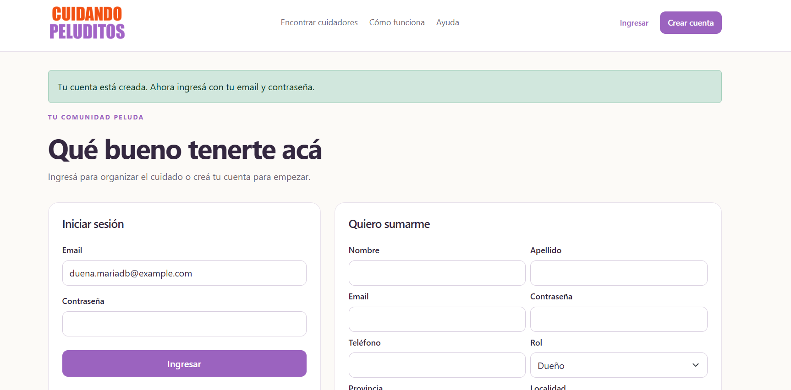

**Ingreso y pantalla de mascotas vacía**

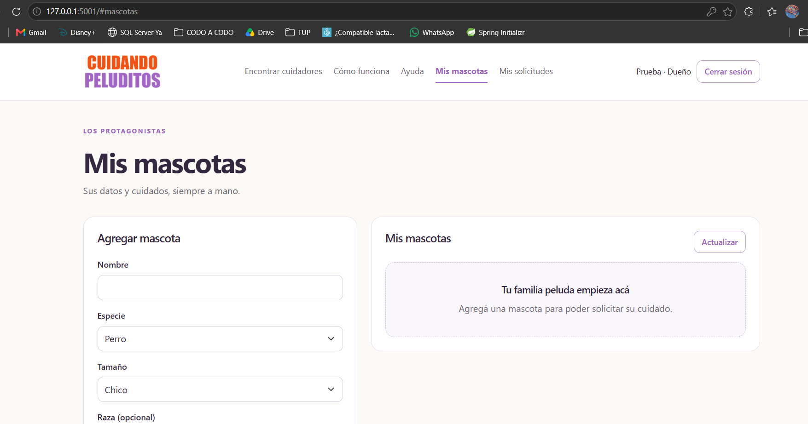

**Luna creada en la aplicación de MariaDB**

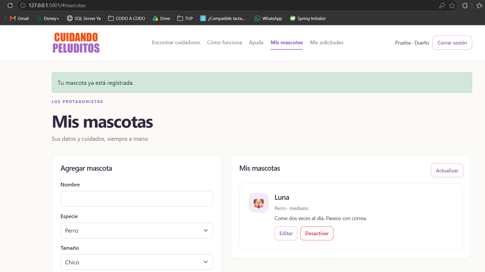

**Raza de Luna actualizada a Mestiza**

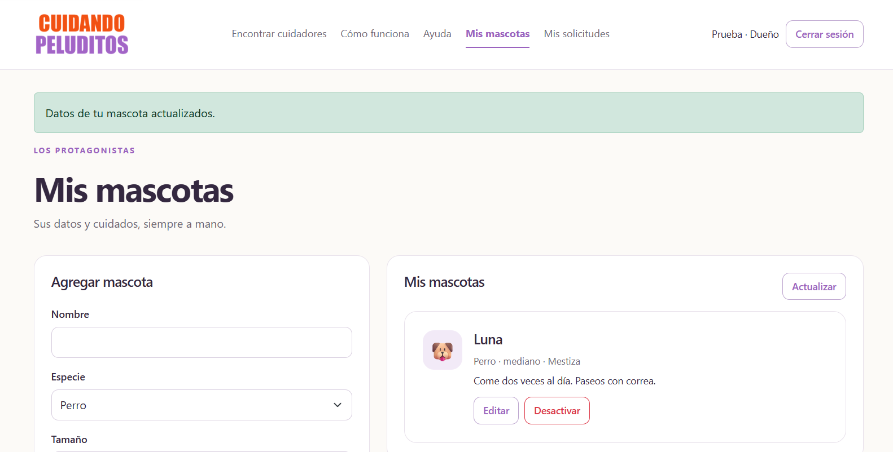

**Agenda deshabilitada antes de crear el perfil**

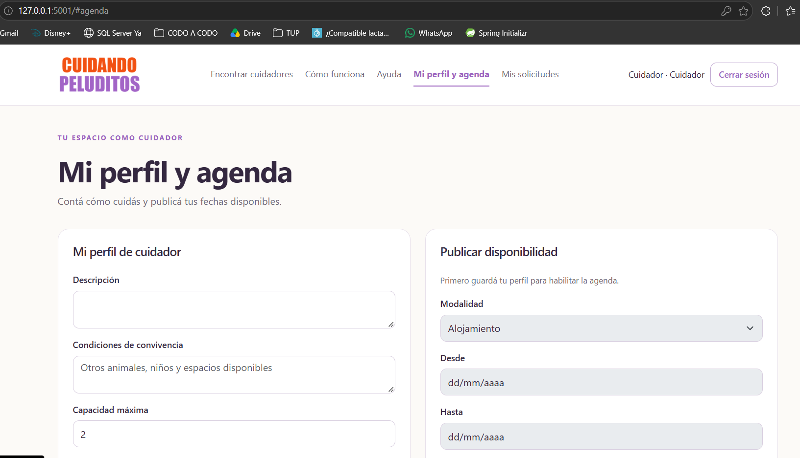

**Perfil creado y agenda habilitada**

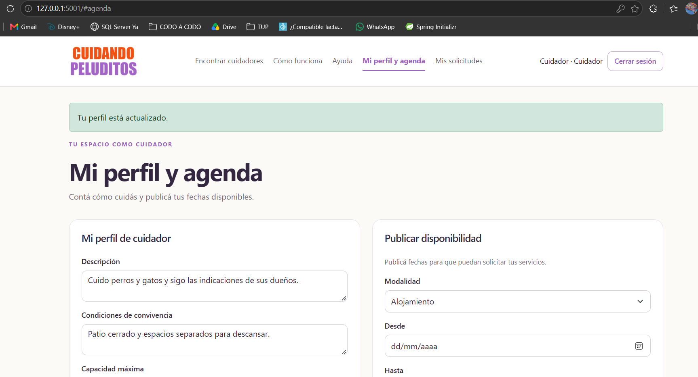

**Disponibilidad corregida al 14–16 de noviembre**

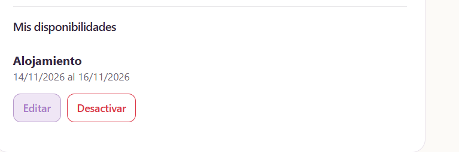

**Alojamiento pendiente para Luna por $24.000**

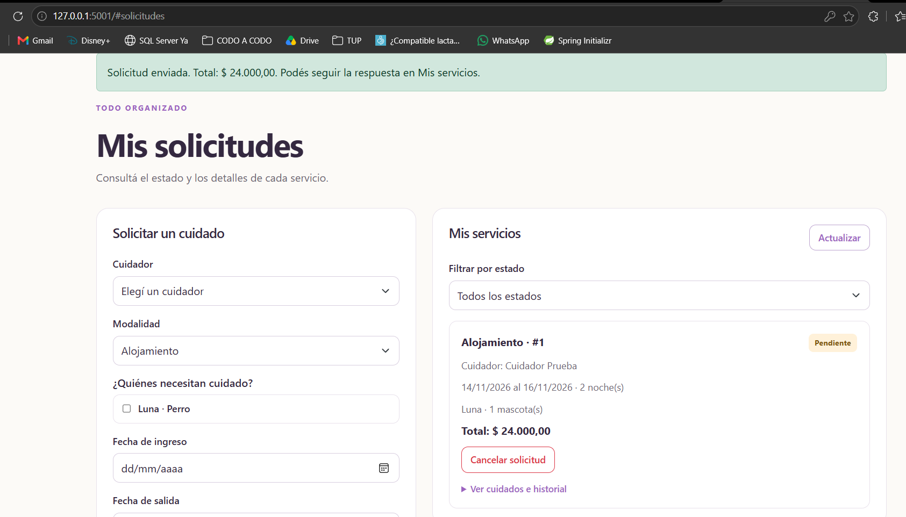

**Alojamiento aceptado e indicaciones del servicio**

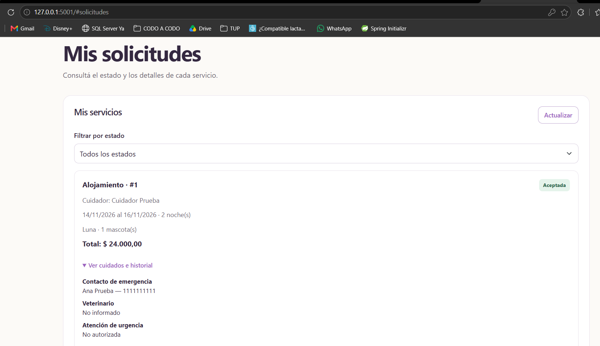

**Catálogo con los cuidadores creados manualmente y por los scripts**

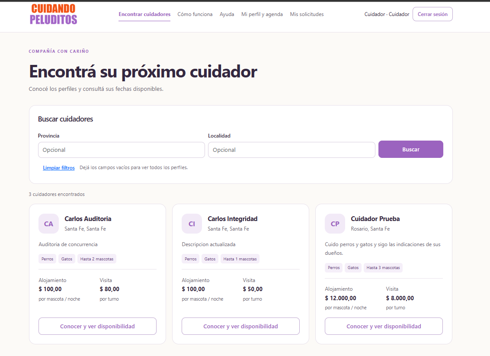

</details>

<details>
<summary>Persistencia y motor de tablas</summary>

**Cuenta guardada en MariaDB**

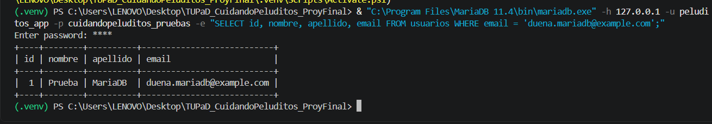

**Datos de Luna y asociación con su dueña**

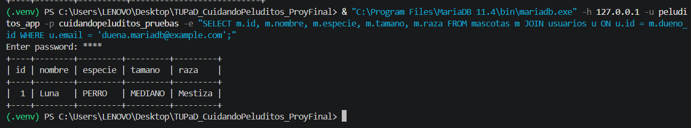

**Estado y cambios de la solicitud #1**

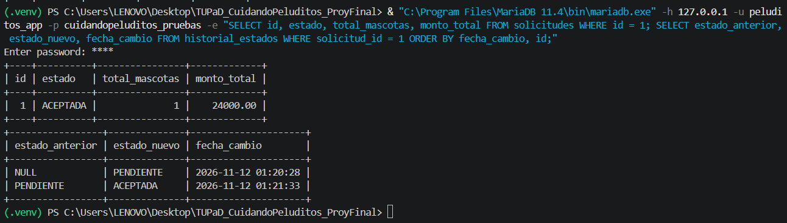

**Todas las tablas consultadas usan InnoDB**

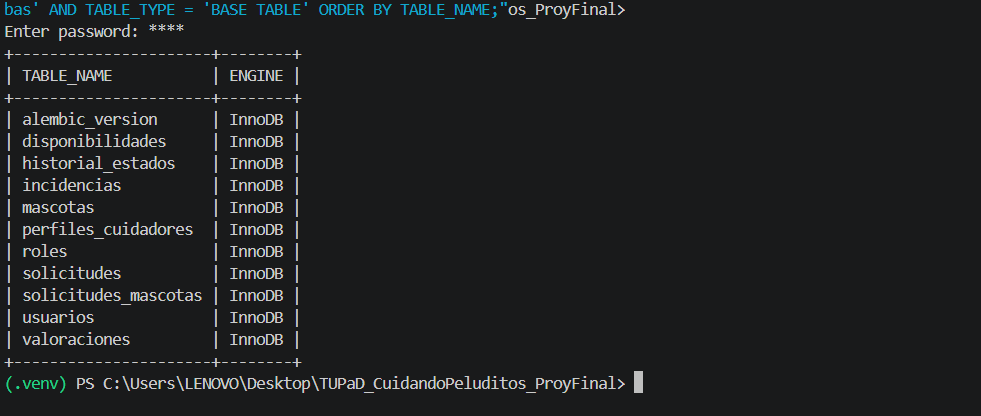

</details>

<details>
<summary>Concurrencia e integridad de alojamiento</summary>

**Preparación y aceptaciones simultáneas de alojamiento**

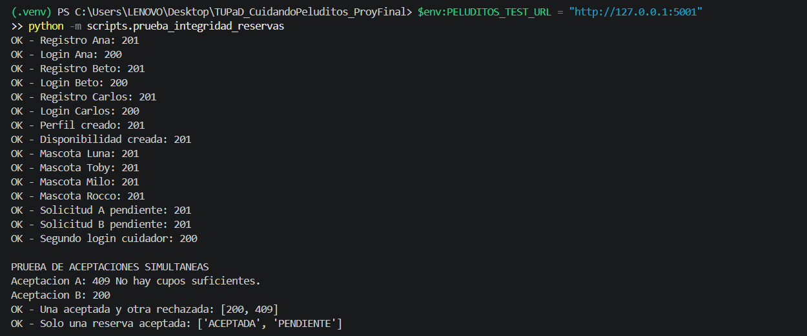

**Protecciones de alojamiento y resultado final**

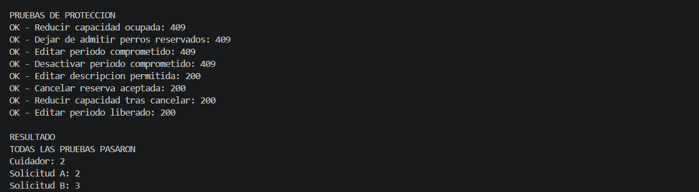

</details>

<details>
<summary>Concurrencia y permisos de visitas</summary>

**Preparación de las pruebas de visitas**

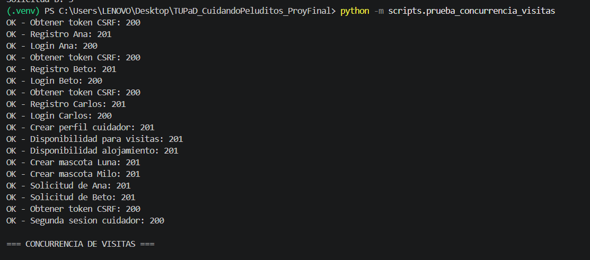

**Concurrencia, permisos, CSRF, liberación y resultado de visitas**

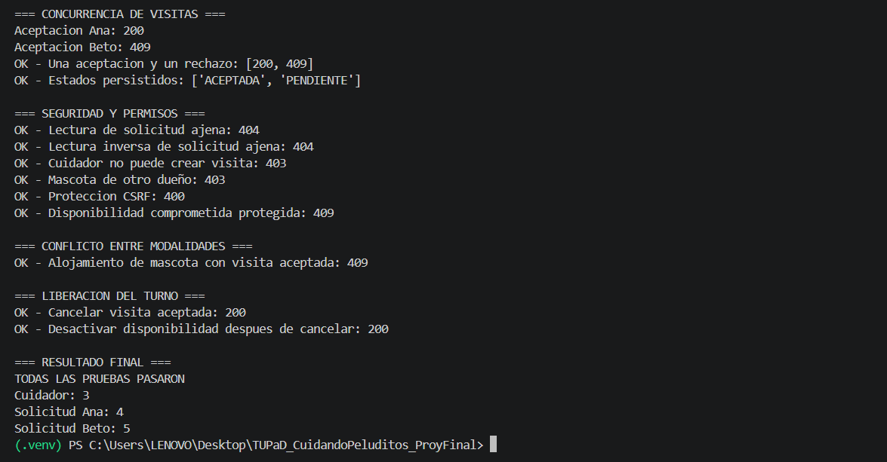

</details>

<details>
<summary>Pruebas complementarias de mascotas y solicitudes</summary>

**Seguridad y baja lógica de mascotas**

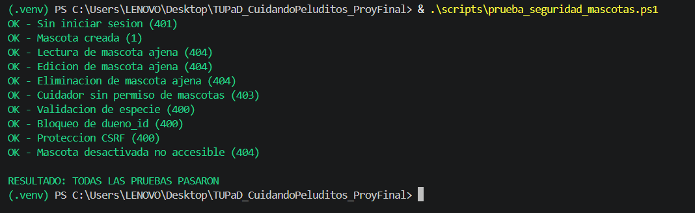

**Reglas y estados de solicitudes**

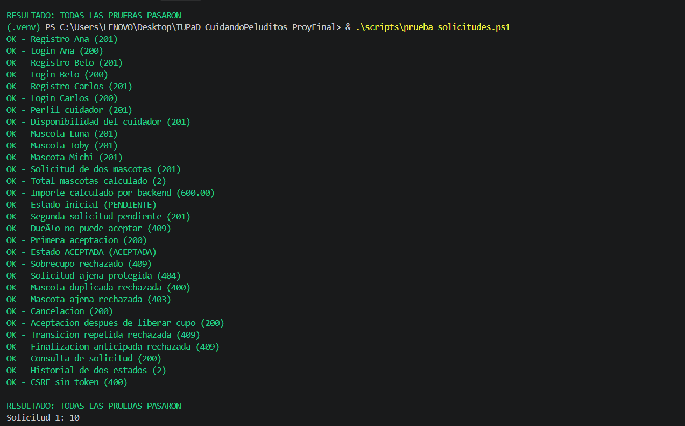

</details>

## Ejecución del proyecto

La [guía de ejecución local con MariaDB](ejecucion-local-mariadb.md) reúne la preparación del entorno, configuración de conexión sin credenciales en el repositorio, migraciones, roles, arranque de Flask y comandos de prueba. También distingue la demo SQLite de la instancia de MariaDB.

## Uso de IA

Se utilizó IA como apoyo para organizar y redactar la documentación de pruebas.
