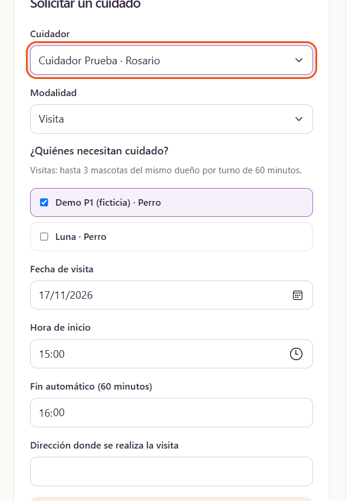

# Regla de nuevas visitas — 15/11/2026

- Cada visita dura exactamente 60 minutos y termina el mismo día.
- Incluye entre 1 y 3 mascotas activas del mismo dueño.
- Total = tarifa por mascota del cuidador × cantidad de mascotas.
- El servidor calcula el horario final y el importe. La hora completa debe estar cubierta por la disponibilidad publicada.
- Una visita ocupa una franja del cuidador, independientemente de cuántas mascotas incluya. El cupo de alojamiento sigue siendo una regla separada.
- Las visitas anteriores conservan sus horarios e importes. No se modifica la base mediante una migración para este cambio.

Ejemplo: tarifa de $8.000; una mascota, $8.000; dos, $16.000; tres, $24.000. Siempre por 60 minutos.

La tarifa de visita ya configurada se interpreta como tarifa por mascota para las nuevas solicitudes. Antes de publicar esta versión corresponde revisar los valores con los cuidadores de la demostración.

## Verificación

Pruebas aisladas: `python -m pytest tests/test_visitas_60_minutos.py -q`.

Resultados del 15/11/2026 en la rama `feat/visitas-60-minutos`, a partir del commit `292f51d`:

| Entorno | Comprobación | Resultado |
|---|---|---|
| SQLite en memoria | Suite completa `python -m pytest tests -q` | 38 aprobadas; incluye 10 casos nuevos de visitas. |
| JavaScript | Sintaxis de `app.js` y cálculo del horario final | Correctos; incluye 10:30 → 11:30 y rechazo de inicio 23:00 por cambio de día. |
| API local en 5001, conectada a MariaDB de pruebas | `python -m scripts.prueba_visitas` | Todas aprobadas. Cuidador #10; solicitudes #26 y #27. |
| API local en 5001, conectada a MariaDB de pruebas | `python -m scripts.prueba_concurrencia_visitas` | Todas aprobadas. Cuidador #11; solicitudes #28 y #29. |
| Navegador local | Inicio 15:00 y final automático 16:00 | Correcto; campo final de solo lectura. |
| Navegador local | Tarifa de $8.000: seleccionar una mascota, agregar otra y quitarla | El estimado pasó de $8.000 a $16.000 y volvió a $8.000. No se envió esta solicitud. |

La prueba de visitas confirmó el total de $160 para dos mascotas con tarifa de $80, permisos, protección CSRF, bloqueo de horarios superpuestos y liberación del turno al cancelar. En la prueba simultánea, Beto obtuvo HTTP 200 y Ana HTTP 409; quedaron una solicitud ACEPTADA y otra PENDIENTE. También se verificaron privacidad, conflicto con alojamiento y desactivación de disponibilidad después de cancelar.

Los casos aislados verificaron el importe con una, dos y tres mascotas, el rechazo de una cuarta, la duración alterada, el horario fuera de disponibilidad y la conservación del horario e importe de una visita anterior. Estas comprobaciones aisladas se ejecutaron con SQLite; no se presentan como pruebas de esos mismos casos en MariaDB.

Los informes anteriores conservan las reglas y resultados correspondientes a su fecha. Estas pruebas locales no equivalen a una validación del despliegue en Render/TiDB.

## Evidencia visual

La captura muestra la duración y el límite indicados en el formulario. La variación del estimado se confirmó durante el recorrido; no se adjuntó una captura de ese importe.
